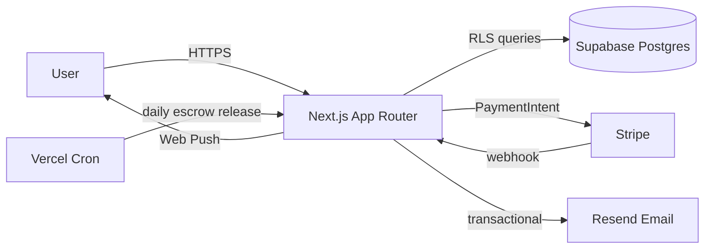
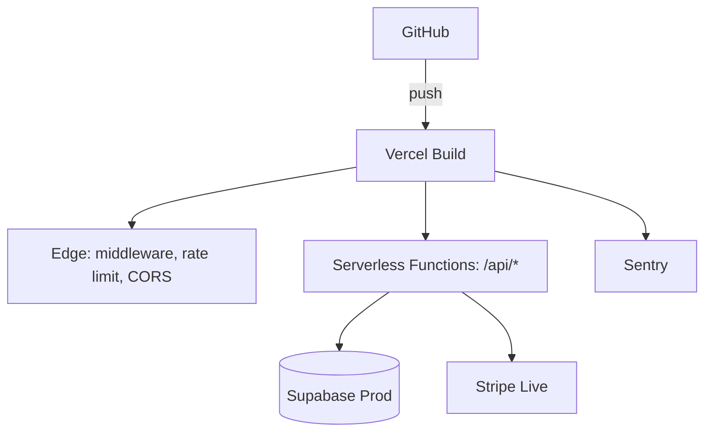

# Safree — Architecture

_Version 0.1.0 · Generated 2026-05-30_

## Overview
Safree is a Next.js 14 (App Router) marketplace and booking platform for outdoor
gear, hunting grounds, and fishing lodges. It uses Supabase (PostgreSQL + PostGIS +
Auth + Storage), Stripe Connect for payments/escrow, Leaflet + OpenStreetMap
(CARTO tiles) for map discovery, Resend for email, and Web Push for notifications.

## Tech Stack
| Package | Version |
|---|---|
| next | 14.2.35 |
| react | ^18 |
| @supabase/supabase-js | ^2.45.4 |
| stripe | ^16.12.0 |
| @stripe/stripe-js | ^4.7.0 |
| leaflet | ^1.9.4 |
| react-leaflet | ^4.2.1 |
| react-leaflet-cluster | ^2.1.0 |
| resend | ^4.0.0 |
| zod | ^3.23.8 |
| zustand | ^4.5.5 |
| @react-pdf/renderer | ^4.5.1 |
| web-push | ^3.6.7 |
| recharts | ^3.8.1 |
| @sentry/nextjs | ^10.55.0 |
| vitest | ^2.1.9 |
| @playwright/test | ^1.60.0 |

## Folder Structure
```
safree/
├── app/
│   ├── (auth)/
│   ├── (dashboard)/
│   ├── (public)/
│   ├── api/
│   └── unauthorized/
├── components/
│   ├── cart/
│   ├── checkout/
│   ├── disputes/
│   ├── forms/
│   ├── layout/
│   ├── legal/
│   ├── maps/
│   ├── notifications/
│   ├── products/
│   ├── reviews/
│   ├── search/
│   └── store/
├── lib/
│   ├── admin/
│   ├── api/
│   ├── auth/
│   ├── bookings/
│   ├── crypto/
│   ├── email/
│   ├── moderation/
│   ├── notifications/
│   ├── pdf/
│   ├── push/
│   ├── stripe/
│   └── supabase/
├── hooks/
├── supabase/
│   ├── migrations/
│   ├── rls-policies/
│   └── seed/
├── scripts/
├── tests/
│   ├── e2e/
│   ├── integration/
│   └── unit/
├── docs/
│   ├── legal/
│   ├── technical/
│   └── user/
```

## Data Flow


## Environment Variables
| Variable | Scope | Value |
|---|---|---|
| NEXT_PUBLIC_SUPABASE_URL | client + server | ••••••• (masked) |
| NEXT_PUBLIC_SUPABASE_ANON_KEY | client + server | ••••••• (masked) |
| SUPABASE_SERVICE_ROLE_KEY | server only | ••••••• (masked) |
| NEXT_PUBLIC_APP_URL | client + server | ••••••• (masked) |
| NEXT_PUBLIC_BASE_URL | client + server | ••••••• (masked) |
| STRIPE_SECRET_KEY | server only | ••••••• (masked) |
| NEXT_PUBLIC_STRIPE_PUBLISHABLE_KEY | client + server | ••••••• (masked) |
| STRIPE_WEBHOOK_SECRET | server only | ••••••• (masked) |
| RESEND_API_KEY | server only | ••••••• (masked) |
| NEXT_PUBLIC_VAPID_PUBLIC_KEY | client + server | ••••••• (masked) |
| VAPID_PRIVATE_KEY | server only | ••••••• (masked) |
| ENCRYPTION_MASTER_KEY | server only | ••••••• (masked) |
| CRON_SECRET | server only | ••••••• (masked) |
| SENTRY_DSN | server only | ••••••• (masked) |
| NEXT_PUBLIC_SENTRY_DSN | client + server | ••••••• (masked) |

## Deployment Architecture

Preview/staging deployments use a separate Supabase project from production.

