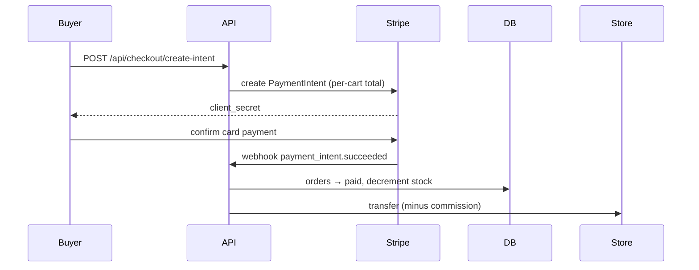

# Safree — Payments & Stripe

_Version 0.1.0 · Generated 2026-05-30_

## Commission
`commission = round(amount × rate% , cents)` — rate read from
`integration_keys.stripe_commission_rate` (default 5%). See `lib/utils/pricing.ts`.

## Product Checkout Flow

## Booking Escrow Timeline
1. Booking paid → funds held on the platform (no immediate transfer).
2. Coto marks the experience **completed** → `release_at = end_date + 7 days`.
3. Vercel Cron (`/api/cron/release-funds`, daily) transfers net funds to the Coto
   if no dispute is open.
4. An open dispute halts release until an admin resolves it.

## Webhook Events Handled
- `payment_intent.succeeded` (orders + bookings)
- `payment_intent.payment_failed`
- `account.updated` (Connect onboarding status)

Every webhook verifies the `stripe-signature` header against `STRIPE_WEBHOOK_SECRET`.

## Stripe Connect Onboarding
Admin creates the store → store clicks "Set up payments" →
`accounts.create({ type: 'standard' })` → hosted onboarding via
`accountLinks.create` → on return, `charges_enabled` flips
`stripe_onboarding_complete`.

